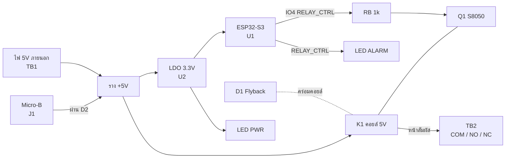

# ESP32-S3 Relay Control Board

บอร์ดควบคุมอุปกรณ์ไฟฟ้าแรงดันต่ำผ่าน **ESP32-S3** โดยใช้ **รีเลย์ 5V (SPDT)** เป็นตัวตัดต่อโหลด
ออกแบบตามโจทย์วิชา (SPU Computer Engineering) ด้วย EasyEDA เป็น PCB 2 ชั้นพร้อม Ground Plane

> สถานะ: อยู่ระหว่างออกแบบ ยังไม่ได้ผลิตและทดสอบกับบอร์ดจริง
> ค่าที่ระบุว่า "ต้องตรวจสอบ" ในเอกสารนี้ยังไม่ได้ยืนยันกับ datasheet หรือการวัดจริง

---

## 1. ภาพรวมการทำงาน



**ลำดับการทำงาน**

1. จ่ายไฟ 5V ที่เทอร์มินัล TB1 (หรือเสียบ USB ตอนอัปโหลดโปรแกรม)
2. LDO แปลง 5V เป็น 3.3V ให้ ESP32-S3 และ LED PWR ติด
3. โปรแกรมสั่งขา IO4 (RELAY_CTRL) เป็น HIGH
4. กระแสจาก IO4 ผ่าน RB เข้าฐานของ Q1 ทำให้ Q1 นำกระแส
5. กระแสไหลผ่านขดลวดรีเลย์ K1 หน้าสัมผัสสลับจาก COM–NC เป็น COM–NO
6. LED ALARM ติดพร้อมกัน เพราะรับสัญญาณ RELAY_CTRL เดียวกัน
7. สั่ง IO4 เป็น LOW รีเลย์ปล่อย หน้าสัมผัสกลับ COM–NC และ LED ALARM ดับ

---

## 2. ความต้องการของโจทย์และการตอบสนอง

| ข้อกำหนด | วิธีที่ออกแบบ |
|---|---|
| รับไฟเลี้ยง 5VDC จากภายนอก พร้อมแหล่งจ่าย 3.3V | เทอร์มินัล TB1 + LDO LM1117T-3.3 |
| Upload Program ผ่าน USB 2.0 Micro-B | J1 Micro-B ต่อ D-/D+ เข้า IO19/IO20 (USB ในตัวชิป) |
| ใช้ GPIO ควบคุมรีเลย์ผ่านทรานซิสเตอร์ ห้ามต่อคอยล์เข้า GPIO ตรงๆ | IO4 → RB → Q1 (S8050) → ขดลวด K1 |
| วงจร Flyback Diode | D1 คร่อมขดลวด แคโทดอยู่ฝั่ง +5V |
| LED Status แสดงเมื่อสั่งรีเลย์ | LED ALARM ต่อจากสาย RELAY_CTRL |
| นำขั้ว COM, NO, NC ออก Terminal Block | TB2 (3 ช่อง) |
| แยกวงจรควบคุมออกจากบริเวณหน้าสัมผัสรีเลย์ | จัดโซนแยกบน PCB และไม่มี GND plane ใต้หน้าสัมผัส |
| PCB ไม่เกิน 60 x 60 mm | ต้องตรวจสอบในไฟล์ PCB |
| PCB 2 ชั้นพร้อม Ground Plane | เท GND ทั้งสองชั้นในโซนควบคุม |

---

## 3. รายการชิ้นส่วน (BOM)

ชิ้นส่วนส่วนใหญ่เป็นแบบทูโฮล ยกเว้นโมดูล ESP32 ที่เป็น SMD
เลขอ้างอิงด้านล่างอาจต่างจากในไฟล์ EasyEDA ให้จับคู่ตามหน้าที่

| อ้างอิง | ชิ้นส่วน | รหัส LCSC | จำนวน |
|---|---|---|---|
| U1 | ESP32-S3-WROOM-1-N16R8 (SMD) | C2913202 | 1 |
| U2 | LM1117T-3.3 (TO-220) | C498321 | 1 |
| J1 | Micro-B 5P ทูโฮล | C962220 | 1 |
| TB1 | เทอร์มินัลสกรู 2 ช่อง 5.08mm | C474952 | 1 |
| TB2 | เทอร์มินัลสกรู 3 ช่อง 5.08mm | C474953 | 1 |
| K1 | รีเลย์ SRD-05VDC-SL-C (SPDT, คอยล์ 5V) | C35449 | 1 |
| Q1 | S8050 NPN (TO-92) | C2931492 | 1 |
| D1, D2 | ไดโอดชอตกี้ 1N5819 (DO-41) | C402218 | 2 |
| D3 | LED เขียว 5mm (LITEON LTL-307G) | C125080 | 1 |
| D4 | LED แดง 5mm | ยังไม่ยืนยันรหัส (ค้น LTL-307EE) | 1 |
| R1, R4 | 10kΩ 1/4W | C410695 | 2 |
| R3 | 1kΩ 1/4W | C410696 | 1 |
| R2, R5 | 220Ω 1/4W | C433749 | 2 |
| C1 | 1uF 50V อิเล็กโทรไลต์ | C2760 | 1 |
| C2, C5 | 100nF 50V X7R ขาเสียบ | C168753 | 2 |
| C3 | 10uF 25V อิเล็กโทรไลต์ | C62932 | 1 |
| C4 | 100uF 16V อิเล็กโทรไลต์ | C311641 | 1 |
| C6 | 22uF 16V อิเล็กโทรไลต์ | C369594 | 1 |
| SW1, SW2 | สวิตช์กด 6x6mm (RESET, BOOT) | C2837515 | 2 |

ก่อนสั่งซื้อให้ตรวจสต็อก ราคา ขั้นต่ำการสั่ง และช่อง Package/Mounting Type ในหน้า lcsc.com ของแต่ละรหัสอีกครั้ง

---

## 4. การเชื่อมต่อขา ESP32-S3

| ขาโมดูล | GPIO | ป้ายสาย | ต่อกับ |
|---|---|---|---|
| 1, 40, 41 | GND | GND | GND |
| 2 | 3V3 | +3V3 | ราง 3.3V |
| 3 | EN | EN | R1 + C1 + ปุ่ม RESET |
| 4 | IO4 | RELAY_CTRL | RB (ไป Q1) และ R5 (ไป LED ALARM) |
| 13 | IO19 | USB_DN | J1 D- |
| 14 | IO20 | USB_DP | J1 D+ |
| 27 | IO0 | BOOT | ปุ่ม BOOT |
| อื่นๆ | | | ไม่ต่อ |

IO35–IO37 ใช้งานไม่ได้ในรุ่น N16R8 เพราะใช้กับ PSRAM
IO4 ไม่ใช่ขา strapping (0, 3, 45, 46) จึงปลอดภัยต่อการบูต

---

## 5. หน้าวงจร (Schematic)

| หน้า | เนื้อหา |
|---|---|
| 1 | ESP32-S3, วงจร EN, ปุ่ม BOOT/RESET, ตัวเก็บประจุกรองไฟ 3V3 |
| 2 | ไฟเข้า (TB1, J1, D2), LDO U2, ตัวเก็บประจุกรองไฟ, LED PWR |
| 3 | วงจรขับรีเลย์ (Q1, RB, RPD, D1, K1), LED ALARM, เทอร์มินัล TB2 |

---

## 6. หลักการคำนวณคร่าวๆ

ค่าเหล่านี้เป็นการคำนวณทั่วไป ยังไม่ได้วัดกับบอร์ดจริง

- **กระแสขดลวดรีเลย์:** ประมาณ 71.4 mA (0.36 W ที่ 5V) ตามข้อมูลของรุ่น SRD-05VDC-SL-C
- **กระแสฐาน Q1:** (3.3 V − 0.7 V) / 1 kΩ ≈ 2.6 mA ซึ่งเพียงพอให้ Q1 อิ่มตัวขับขดลวด
- **RPD (10kΩ):** ดึงฐาน Q1 ลง GND ตอนบูต ไม่ให้รีเลย์ทำงานเอง
- **กระแส LED:** (3.3 V − Vf) / 220 Ω โดย Vf ของ LED ต้องตรวจจาก datasheet ของรุ่นที่ใช้

---

## 7. กฎการออกแบบ PCB

1. ขนาดบอร์ดไม่เกิน 60 x 60 mm, 2 ชั้น
2. เทแผ่น GND (Ground Plane) ทั้งสองชั้นในโซนควบคุม
3. ปลายเสาอากาศของ U1 อยู่ชิดขอบบอร์ด และไม่มีทองแดงหรือชิ้นส่วนใต้และรอบเสา
4. แยกโซนควบคุม (ESP32, Q1, LED) ออกจากโซนหน้าสัมผัส (K1 ขา COM/NO/NC, TB2)
5. ไม่มี GND ของวงจรควบคุมใต้โซนหน้าสัมผัส
6. วางตัวเก็บประจุ 100nF ชิดขา 3V3 ของ U1
7. เพิ่มรูยึดบอร์ดที่มุมทั้งสี่

---

## 8. วิธีใช้งานและทดสอบ

**อัปโหลดโปรแกรม**

1. เสียบสาย Micro-B เข้าคอมพิวเตอร์
2. กดปุ่ม BOOT ค้างไว้ แล้วกด RESET หนึ่งครั้ง จากนั้นปล่อย BOOT
3. อัปโหลดโปรแกรมผ่าน Arduino IDE หรือ PlatformIO (เลือกบอร์ด ESP32-S3)

**โค้ดตัวอย่างทดสอบรีเลย์**

```cpp
const int RELAY_PIN = 4;   // RELAY_CTRL

void setup() {
  pinMode(RELAY_PIN, OUTPUT);
  digitalWrite(RELAY_PIN, LOW);
}

void loop() {
  digitalWrite(RELAY_PIN, HIGH);  // รีเลย์ทำงาน และ LED ALARM ติด
  delay(2000);
  digitalWrite(RELAY_PIN, LOW);   // รีเลย์ปล่อย
  delay(2000);
}
```

**ลำดับทดสอบหลังประกอบ**

1. ยังไม่ใส่ ESP32: จ่ายไฟ 5V แล้ววัดราง +3V3 ควรได้ประมาณ 3.3V และ LED PWR ติด
2. ตรวจว่ากระแสรวมไม่สูงผิดปกติ
3. ใส่ ESP32 แล้วเสียบ USB ตรวจว่าคอมพิวเตอร์เห็นอุปกรณ์ USB
4. อัปโหลดโค้ดทดสอบ ฟังเสียงคลิกของรีเลย์ และดู LED ALARM
5. ต่อโหลดแรงดันต่ำที่ TB2 ตรวจการสลับ COM–NO และ COM–NC

---

## 9. ข้อควรระวังและข้อจำกัด

- **ไฟตกคร่อมที่ D2:** ถ้าจ่ายไฟจาก USB อย่างเดียว ราง +5V ต่ำลงประมาณ 0.3–0.55V ซึ่งอาจใกล้ขอบที่ LDO ต้องการ แนะนำใช้ USB เพื่ออัปโหลดโปรแกรม และใช้ไฟ 5V ภายนอกตอนใช้งานจริง
- **ตัวเก็บประจุขาออกของ LDO:** ค่า 22uF ต้องตรวจกับ datasheet ของ LM1117T-3.3 (HGSEMI)
- **ลำดับขาของ LM1117T, Micro-B และ S8050:** ต้องเทียบกับสัญลักษณ์และ datasheet ก่อนต่อจริง
- **ความสูงของชิ้นส่วนทูโฮล:** TO-220 และเทอร์มินัลค่อนข้างสูง ตรวจให้พอดีกับขนาดบอร์ดและเคส
- **พิกัดหน้าสัมผัสรีเลย์:** ข้อมูลที่พบคือ 10A ที่ 28VDC หรือ 250VAC เหมาะกับโหลด DC แรงดันต่ำตามโจทย์ ถ้าจะใช้ไฟบ้านต้องออกแบบระยะห่างและช่องกั้นเพิ่ม
- **การบัดกรี:** โมดูล ESP32 เป็น SMD บัดกรีด้วยมือยากกว่าชิ้นอื่น

---


